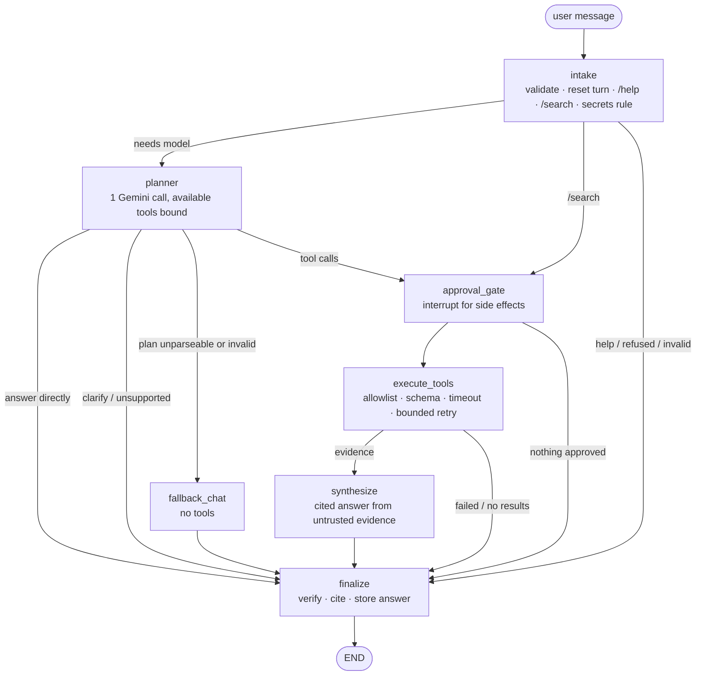
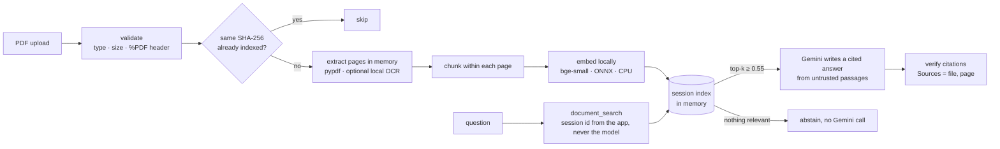

# OmniFlow AI

**One AI. Every Task. Seamless Execution.**

OmniFlow AI is a multimodal AI assistant built with LangGraph, featuring research, weather,
currency conversion, document RAG, data analysis, SQL, planning, coding assistance, memory,
and image generation.

OmniFlow AI is a modular, agentic assistant built with LangGraph, Google Gemini and
Streamlit. It extends the [CampusX LangGraph chatbot tutorial](https://github.com/campusx-official/chatbot-in-langgraph)
and is being built in small, verified phases.

> **Current state: Integrations milestone, revised** (image generation via Cloudflare
> Workers AI with your own free credentials; Gmail and Google Calendar removed). A
> LangGraph agent that answers directly when it can, answers questions about your uploaded
> PDFs with page citations, analyses CSV/Excel files with pandas (tables and charts), queries
> SQLite databases read-only, researches the web, recent news, official announcements and
> academic papers with citations, and reads images you attach (JPEG, PNG, WebP). Assistant
> conversations are saved on your computer and can be reopened after a restart. **Free only:** every provider is keyless, and the only API key is
> the free Gemini key. See [docs/STATUS.md](docs/STATUS.md) for what is verified.

## Quick start (Windows PowerShell)

```powershell
# 1. Create the project virtual environment (Python 3.12) - once
py -3.12 -m venv .venv

# 2. Install dependencies into it
.\.venv\Scripts\python.exe -m pip install -r requirements-dev.txt

# 3. Configure your Gemini key locally (see docs/API_KEYS_AND_SERVICES.md)
Copy-Item .env.example .env
notepad .env          # set GEMINI_API_KEY=...

# 4. Check configuration (add --live to verify the key with Gemini)
.\.venv\Scripts\python.exe -m omniflow.diagnostics --live

# 5. Run the app
.\.venv\Scripts\python.exe -m streamlit run app.py
```

Calling `.\.venv\Scripts\python.exe` directly means you never need to "activate" the venv.
That avoids PowerShell's script execution policy, which can block `Activate.ps1`. If you
prefer activation, run `Set-ExecutionPolicy -Scope Process -ExecutionPolicy Bypass`
(current window only) and then `.\.venv\Scripts\Activate.ps1`.

The app starts without a key and shows setup instructions; chat is enabled once
`GEMINI_API_KEY` is set.

## Asking questions about your PDFs

1. Start the app (step 5 above) and open the **📄 Documents** page in the sidebar.
2. Choose one or more PDFs (up to 10 per session, 20 MB and 300 pages each), then click
   **Process N file(s)**. The first time, the local embedding model downloads once (~67 MB).
3. Check the list: each file shows its pages, how many have text, and how many passages were
   indexed. Use **Test retrieval** to see which passages a question finds; this makes no
   AI call.
4. Go to **💬 Assistant** and ask, for example, *"What does the handbook say about leave?"*.
   The assistant uses `document_search` when relevant. Turn on **Answer from my documents
   only** (or type `/docs <question>`) to always answer from your PDFs.
5. Each answer shows **Sources** such as `handbook.pdf, page 2`, a verification badge, and an
   **Evidence** panel with the exact passages used. If the PDFs don't contain the answer, it
   says so instead of guessing.
6. **Remove** a file or **Clear all documents** on the Documents page. Documents also
   disappear after 120 minutes of inactivity or when the app restarts.

**Scanned PDFs:** pages that are images need the free, local Tesseract OCR program, which
is optional (`winget install --id UB-Mannheim.TesseractOCR -e`, then restart the app).
Without it, those pages are listed as not searchable.

## Analysing CSV / Excel files

1. Open **📊 Data Analysis**, choose `.csv` or `.xlsx` files (up to 5 per session, 20 MB,
   200,000 rows and 200 columns each), and click **Load**.
2. Pick a dataset to see its size, duplicates and missing values, then:
   - **🧾 Profile**: per-column type, missing values, statistics, outliers, top values,
     and the strongest correlations. Identifier columns such as `order_id` are excluded
     from the numeric analysis.
   - **👀 Preview**: the first 50 rows.
   - **📈 Quick chart**: bar, line, histogram, scatter or correlation heatmap, built
     directly with **no AI call**.
   Below the tabs, **💬 Ask about your data** is a conversation with an input pinned to the
   bottom of the page, so it stays visible however long the answers get. Ask questions such
   as *"Which products generate the highest revenue?"*. Gemini picks one allowlisted
   operation, **pandas computes the result**, and the answer shows the operation, the result
   table or chart, and any notes. **Clear conversation** resets the thread and keeps the
   dataset.
3. Use **Download CSV** to save a result. Cells that begin with `=`, `+`, `-` or `@` are
   neutralised so spreadsheets won't run them as formulas.
4. Use **Remove this dataset** or **Clear all datasets** when you're done. Data stays in
   memory only.

You can also ask about loaded datasets on the 💬 Assistant page.

## Querying a SQLite database (read-only)

1. Open **🗄️ SQL**. By default it uses a generated **SAMPLE DATA** shop database
   (fictional customers, products and orders), labelled as sample everywhere.
   - **To query your own data:** open **📥 Import CSV/XLSX into SQL**, then either pick a
     dataset already loaded on the Data Analysis page or upload a CSV/XLSX there.
   - Check the preview and the column/type mapping, adjust the table name if you like
     (e.g. `BlinkIT Grocery Data (1).csv` → `blinkit_grocery_data_1`), and click **Import**.
   - The table goes into **`imported_data`**, a private SQLite database for your browser
     session only, and it becomes the selected database.
   - Importing is a manual step; the AI can only *read* imported tables. Up to 5 tables per
     session, with the same size, row and column limits as Data Analysis.
   - **Delete imported tables** removes the session's database file. It's also removed
     after 120 minutes idle and when the app stops.
2. Open the **Schema browser** to see the allowlisted tables and columns.
3. **Ask about the selected database** in plain English (the input is pinned at the bottom),
   for example *"Which product category had the highest revenue in 2025?"*. The AI can query
   **only the selected database**. The generated SQL, its execution status and the result
   table are shown with the answer.
4. **Run your own SELECT** validates and runs your query with the same safeguards, with no
   AI call. Try `DROP TABLE orders` to see it blocked.

To use **your own** SQLite file, add these to `.env` and restart. Both the path and the
table allowlist are required; it is always opened read-only:

```
OMNIFLOW_SQL_DATABASE_PATH=C:\path\to\your.db
OMNIFLOW_SQL_DATABASE_NAME=my_database
OMNIFLOW_SQL_ALLOWED_TABLES=table_one,table_two
OMNIFLOW_SQL_BLOCKED_COLUMNS=table_one.secret_column
```

To regenerate the sample: `.\.venv\Scripts\python.exe -m omniflow.sql.sample_data --force`.

## Web, news and academic research

Ask on the **💬 Assistant** page. The agent picks the right tool, or you can force one:

| You ask | Tool | Sources | Command |
|---|---|---|---|
| Research questions needing several current sources (*"Research the state of solid-state batteries"*) | `tavily_search` (needs `TAVILY_API_KEY`) | Tavily Search API: ranked results (title, link, excerpt, relevance score) | `/research <question>` |
| General facts on the web | `web_search` | DuckDuckGo results (title, link, domain, snippet) | `/search <query>` |
| *"Latest developments in generative AI"*, trends, official announcements | `news_search` | DuckDuckGo News + official RSS: WHO, NASA, Reserve Bank of India, European Commission, arXiv cs.AI | `/news <topic>` |
| *"Find recent papers on RAG evaluation"*, comparing studies | `academic_search` | OpenAlex + arXiv (title, authors, year, venue, DOI, abstract) | `/papers <topic>` |

It uses two tools together only when you clearly ask for both (e.g. *"compare recent
research with industry announcements"*).

### Tavily Research Agent (optional)

`tavily_search` uses the official [Tavily Search API](https://docs.tavily.com) with **your
own** key. It's one more tool in the same registry, so the planner, approval-free read-only
execution, citations, verification and abstention all work exactly as for `web_search`.

- **Setup:** create a free key at <https://app.tavily.com> and add one line to your local
  `.env` (never commit it): `TAVILY_API_KEY=...`. Restart the app. Optional limits:
  `OMNIFLOW_TAVILY_TIMEOUT_SECONDS` (default 15) and `OMNIFLOW_TAVILY_MAX_RESULTS`
  (default 5, at most 10).
- **Routing:** when the key is set, the planner is told to prefer `tavily_search` for
  research questions that need several reliable, current sources, and `web_search` for quick
  lookups. Greetings, arithmetic, uploaded documents, datasets, databases and general
  knowledge don't trigger a search. `/research <question>` calls Tavily directly.
- **What is sent:** only the query, with `search_depth=basic` (1 Tavily credit per search).
  OmniFlow doesn't request Tavily's generated answer, raw page content or images, so every
  claim must cite a returned source. Each result is cut to 200 characters of title and 500 of
  excerpt.
- **Without a key:** the app starts normally; `tavily_search` is listed as unavailable in
  `/help`, isn't offered to the model (which then uses `web_search`), and `/research` replies
  with the setup instruction above.
- **When Tavily fails:** you get a specific message and the assistant does not answer from
  memory. Invalid key (401), invalid request (400/422) and plan or credit limits (432/433) are
  never retried. Rate limiting (429), server errors (5xx), timeouts and network errors are
  retried once. Malformed responses are reported, and an empty result says nothing was found.
- **Limits (checked 2026-10-14 on docs.tavily.com):** the free Researcher plan includes 1,000
  API credits per month with no credit card. Development keys are limited to 100 requests per
  minute. Results are a ranked sample of the web, not an exhaustive or real-time index.
- **Tests:** `.\.venv\Scripts\python.exe -m pytest tests/test_tavily_search.py` (mocked
  HTTP; no key or network needed).

**What you see:**
- **Sources** at the end of every answer, built from real results, never written by the
  model. News items show the publisher and **publication date**. Papers show
  `Authors (year). Title. Venue. doi:…`.
- **Evidence** panels with publication *and* retrieval dates (UTC), and paper abstracts.
- A tool-activity line that says when a source returned nothing or was unavailable.

**How to read the answers:**
- News answers are based on **headlines and short summaries**. Articles aren't opened.
- Paper answers are **abstract-based**; full texts aren't read or downloaded. Papers
  without an abstract are marked "metadata only".
- This is **on-demand search, not monitoring**. Each question triggers a fresh lookup,
  and feeds only contain what publishers have posted.
- If nothing relevant is found, the assistant says so instead of answering from memory.
- **Free limits:**
  - OpenAlex allows about **100 keyless searches per day**.
  - arXiv allows one request every 3 seconds, which OmniFlow enforces.
  - DuckDuckGo News can temporarily return nothing after many requests.

## Weather (Open-Meteo)

Ask on the **💬 Assistant** page, e.g. *"What's the weather in Pune?"*, *"Will it rain in
Paris this weekend?"*, *"5-day forecast for Denver in Fahrenheit"*, or use
`/weather <place>` (current conditions + 3-day forecast). The planner sends weather and
forecast questions to the `weather_lookup` tool, never to web search, and doesn't call it
for anything else.

- **What you get:** current conditions (conditions, temperature, feels-like, humidity,
  precipitation in the latest 15-minute interval, wind speed, direction and gusts) and a
  daily forecast for 1-16 days (conditions, low/high, precipitation total, maximum chance
  of precipitation, maximum wind). Units are metric (°C, km/h, mm) unless you ask for
  imperial (°F, mph, in).
- **Places:** the name is resolved by Open-Meteo's geocoding API, and its coordinates are
  used. OmniFlow never guesses coordinates. Add a region or country to be precise
  (*"Springfield, Illinois"*, *"Paris, France"*). If several different places match and none
  is at least 10 times more populous than the rest, the assistant **asks which one you
  mean**. If one clearly dominates (Paris, France over Paris, Texas), it's used and the
  other matches are mentioned.
- **Times:** dates and times are **local to the place** (timezone name, abbreviation and UTC
  offset are shown).
- **Accuracy:** "current" values are model estimates for that location, not a weather
  station reading, and forecasts are predictions, not guarantees. Values Open-Meteo doesn't
  return are reported as "not provided", and numbers in the answer that aren't in the data
  are flagged by the verifier.
- **Provider and attribution:** [Open-Meteo](https://open-meteo.com/) free API, no account
  or key. Its free use is for **non-commercial** purposes, with fewer than 10,000 calls a
  day, 5,000 an hour and 600 a minute. The data are licensed **CC BY 4.0**, and every answer
  and evidence panel credits "Weather data by Open-Meteo.com" (terms checked 2026-10-14). Each
  lookup makes 2 calls (geocoding + forecast). Place names are sent to Open-Meteo.
- **Failures:**
  - Unknown places and ambiguous names produce a question for you, not an error.
  - Timeouts (10 s per request), network errors and 5xx errors are retried once.
  - Rate limits (429) and rejected requests are not retried.
  - Malformed responses are reported. In every case the assistant doesn't answer from
    memory, and the rest of the app keeps working.
- **Turn it off:** `OMNIFLOW_WEATHER_ENABLED=false` in `.env`.
- **Tests:** `.\.venv\Scripts\python.exe -m pytest tests/test_weather.py` (mocked HTTP; no
  network).

## Currency conversion & exchange rates (Frankfurter)

Ask on the **💬 Assistant** page, for example:
- *"Convert 1000 INR to USD"*, *"Convert 50 USD to INR"*
- *"What is the EUR to INR exchange rate?"*
- *"What was the EUR to INR rate on 2025-01-15?"*

The planner sends these to the `currency_convert` tool, which makes one request to the
public [Frankfurter API](https://frankfurter.dev/) (`api.frankfurter.dev/v2/rate/{FROM}/{TO}`,
optional `?date=YYYY-MM-DD`). **No API key or account is needed.**

- **What the answer shows:** the original amount and currency, the converted amount, the
  rate used and its **reference date**. A Sources entry links to the exact Frankfurter rate
  URL for that date, and the evidence panel shows the full calculation.
- **Reference rates, not live prices:** Frankfurter publishes mid-market rates blended
  from central banks and official sources. They are **not** live trading quotes and may
  differ from what a bank, card, remittance service or exchange bureau charges.
- **Arithmetic:** done by OmniFlow (Frankfurter doesn't convert) in exact decimals. Only
  the displayed amount is rounded: 2 decimals, or 6 below 1.
- **Currencies:** 3-letter ISO codes (USD, EUR, INR, …) or unambiguous names (*euro*,
  *Indian rupee*, *Japanese yen*). Ambiguous names (*dollar*, *rupee*, *pound*, *peso*) and a
  missing currency get a question back; the assistant never assumes a target currency.
- **History:** data starts in 1948, but coverage varies by currency. If Frankfurter has no
  rate for a pair on a date (future dates, dates before a currency's coverage), the
  assistant says so instead of using another date. If Frankfurter returns a rate dated
  differently from the date you asked for, both dates are shown.
- **Failures:**
  - Invalid amounts (zero, negative, non-numeric, over 1 trillion), invalid dates and
    unsupported codes (HTTP 422) are explained, and nothing is fetched or guessed.
  - Timeouts (10 s), network errors and 5xx errors are retried once; 4xx and 429 are not
    retried.
  - Malformed responses are reported, and the assistant never answers with a rate from
    memory.
- **Not included:** forecasts, trading prices and investment advice.
- **Turn it off:** `OMNIFLOW_CURRENCY_ENABLED=false` in `.env`.
- **Tests:** `.\.venv\Scripts\python.exe -m pytest tests/test_currency.py` (mocked HTTP; no
  network).

## Saved conversations

Every **💬 Assistant** conversation is saved automatically on this computer:

- **➕ New chat** starts a fresh conversation. The previous one stays in the sidebar under
  **Conversations**. Click a title to reopen it, with its messages, sources, tables,
  charts, attached images and the agent's memory of the conversation.
- **⋯** next to a title lets you **rename** it or **delete** it. Deleting asks for
  confirmation, then permanently removes its messages, images and agent memory.
- **Refreshing the browser** reopens the conversation you were in (its id is kept in the
  page URL as `?c=…`). **Restarting the app** keeps everything; reopen from the sidebar.
- A conversation is saved only once you send its first message.
- If a reply is cut off (you sent another message, switched page or closed the tab while it
  was streaming), the partial text is kept and marked **interrupted**. A question that got
  no reply at all is marked too.
- A pending approval is still pending after a reload or restart.

**Where it is stored** (both in the gitignored `data/` folder):

| File | Contents |
|---|---|
| `data/omniflow_conversations.db` | Titles, the messages shown on screen (with sources, tables, charts), attached images |
| `data/omniflow_checkpoints.db` | The agent's LangGraph checkpoints: what the model remembers in each conversation |

Change the locations with `OMNIFLOW_CONVERSATIONS_DB` and `OMNIFLOW_CHECKPOINTS_DB`, or turn
saving off with `OMNIFLOW_HISTORY_ENABLED=false`. Message text is passed through the same
secret redaction as the logs before it is saved. The files are **not encrypted**; anyone with
access to your Windows account can read them.

**Backup:** stop the app, then copy both files (and any `-wal`/`-shm` files next to them)
somewhere safe. To restore, stop the app and copy them back. To erase all history, stop
the app and delete them.

Only the Assistant page is saved. Questions on the Data Analysis and SQL pages, uploaded
PDFs and datasets are still kept in memory for the current session only.

## Image generation & multi-tool orchestration (🔌 Integrations page)

**Image generation** is OmniFlow's only external integration. The provider is chosen only
by `OMNIFLOW_IMAGE_PROVIDER`:

| Value | What happens |
|---|---|
| `disabled` (default) | No image generation |
| `mock` | A coloured placeholder stamped "MOCK - not AI-generated", always labelled *MOCK placeholder image (not AI-generated)*. For development and tests |
| `cloudflare` | Real images from Cloudflare Workers AI (`flux-1-schnell`) using your `CLOUDFLARE_ACCOUNT_ID` and `CLOUDFLARE_API_TOKEN` |

- **Approval:** each image is proposed in the Assistant chat with its prompt and provider,
  and is generated only after **Approve this exact action**. Rejecting creates nothing.
- **Failures are never hidden:** if Cloudflare fails, you see its error, for example *"rejected the
  API token (HTTP 401)"* with Cloudflare's numeric error code, or *"free daily allocation
  was reached (HTTP 429)"*. There's no automatic retry and no fallback to the mock.
- **Storage:** images are saved under `data/generated_images/` (gitignored) with new file
  names; nothing is overwritten.
- **Cost:** Gemini image models have no free tier (Google's pricing page, checked
  2026-10-13), so they aren't used. Cloudflare's Free plan includes 10,000 Neurons a day
  and fails rather than billing when that's used up. Prompts are sent to Cloudflare.

**Gmail and Google Calendar were removed** (2026-10-13). OmniFlow has no access to email or
calendar accounts. To plan from emails or meeting notes, upload them as a PDF on the
Documents page, or paste the text, and ask the Assistant to turn the action items into a
plan.

**Orchestration:** the assistant can chain up to 3 tool rounds per question
(`OMNIFLOW_MAX_TOOL_ROUNDS`). For example: search your uploaded documents → propose a
planner plan from the action items found.
- **When a next round happens:** only when the synthesis step, with all evidence
  quarantined, decides the request needs a step that depends on the results. Text inside
  documents, pages or data can't trigger tools.
- **Limits:** the tool-call and step budgets apply to the whole question, and calls that
  have run aren't repeated.
- **Proposals stay proposals:** planner results are saved on the Planner page, and memory
  suggestions appear as a **Save it** card.

## Data storytelling & forecasting (📊 Data Analysis page)

Under **📖 Storytelling & forecasting** on the Data Analysis page, pick an action. Every
number is computed locally with pandas and NumPy when you click; nothing is saved and the
dataset is never changed. **Explain with Gemini** asks the page's chat to re-run the same
computation and explain it.

| Action | What it computes |
|---|---|
| **Data story** | Data quality, KPIs of the main measure, group comparisons (totals, means, shares, concentration), the trend over time, outlier rows, strong correlations (labelled as association only), limitations, and numbered findings F1, F2… |
| **Trends** | Overall and period-over-period changes (a % change is undefined when the base is 0), OLS slope, Mann–Kendall trend test, unusual periods, a seasonality check, gaps and irregular dates |
| **Outliers** | The existing outlier operation, now with a robust option: 1.5×IQR, robust z (median/MAD) > 3.5, or z > 3 |
| **Forecast** | Validates the series, compares methods on past data against a naive baseline, then forecasts with approximate 95% intervals (chart with history, holdout predictions, forecast, band and boundary) |
| **Recommendations** | Rule-based actions, each citing the findings behind it, with evidence, assumptions and a confidence label: high-confidence, tentative or requires more data. Never outcome promises |

In the chat you can also ask *"Summarize the most important findings"*, *"What are the main
revenue trends?"* or *"Forecast revenue for 6 months"*. The tools are `dataset_story`,
`dataset_trends` and `dataset_forecast`.

**How a series is prepared:**
- **Columns:** you choose the date and numeric columns. OmniFlow never guesses a forecast
  target, and ID or code columns are refused.
- **Dropped rows:** unparseable dates and missing values are dropped and counted, never
  imputed.
- **Combining rows:** rows in the same period, including duplicate timestamps, are combined
  with **sum** (totals) or **mean** (levels), whichever you choose.
- **Frequency:** chosen by you, or inferred as the finest period that's regular or holds at
  least 5 rows on average, so sums aren't driven by how dates fall into bins.
- **Partial periods:** a first or last period the data only partly covers is dropped and
  reported.
- **Gaps:** empty periods are never filled silently. Trends show them as gaps. Forecasting
  refuses gappy series unless you explicitly choose *treat as zero* (totals only) or
  *interpolate* (at most 10% of periods, runs of at most 2).

**Trend methods and assumptions:**
- **Mann–Kendall:** two-sided, normal approximation with tie correction, needs ≥ 8 periods.
  It assumes independent periods. A trend is called *statistically detectable* only when
  p < 0.05.
- **Unusual periods:** each value is compared with the median of its four neighbours; robust
  z > 3.5 is flagged (Iglewicz–Hoaglin). The first and last two periods aren't assessed. For
  sums, the per-record average must be unusual too, so busier periods aren't flagged just
  for having more records. A flag means unusual, not an error or fraud.
- **Seasonality:** the lag-m autocorrelation of the de-trended series is compared with
  1.96/√n, only with at least two full cycles. It's a "possible pattern", not proof.

**Forecasting:**
- **Candidates:** naive (the baseline), seasonal-naive (with ≥ 2 full seasons),
  3-period moving average, drift, linear trend, and Holt's linear smoothing (a fixed 4×4
  parameter grid chosen on training data only). NumPy only; no new packages.
- **Evaluation:** rolling-origin holdout, up to 3 chronological folds, no shuffling. Every
  fit, parameter choice and scaling uses only data before its test window.
- **Metrics:**
  - MAE and RMSE.
  - MASE, scaled by the naive one-step MAE of the first training window.
  - MAPE, only when every actual is positive.
  - Skill versus naive.
  - Measured 95% interval coverage.
- **Selection:** a method replaces naive only if its MAE is at least 10% lower overall **and**
  it's better than naive in every fold (at least 20% lower with a single fold). Otherwise
  naive is kept, and that's reported.
- **Intervals:** approximate 95% intervals from standard formulas, assuming normal,
  uncorrelated errors. They're estimates, not guarantees, which is why holdout coverage is
  shown.
- **Limits:** at least 12 observations, horizon ≤ 24 (configurable) and ≤ half the history,
  at most 5,000 periods.

**Evaluation (synthetic, deterministic):** `python -m omniflow.data.evaluate` measures the
methods over 20 seeds per scenario.
- **Trends and anomalies:** trend direction 60/60, planted anomalies 40/40 found with no
  false flags.
- **Model selection:** seasonal-naive was chosen for 20/20 seasonal series, and a trend
  method beat naive on 20/20 trending series.
- **Random walks:** naive (the theoretically optimal method) was kept for **15/20**; the
  other 5 picked a method that happened to do better on the short holdouts.
- **Intervals:** measured 95% interval coverage 0.95.
- These figures describe synthetic data, not your data or the quality of Gemini's
  explanations.

## Planner (🗂️ Planner page)

Turn a goal into a plan, save it as a project, and track it.

**1. Plan a goal.** Describe it (e.g. *"Finish my data analytics portfolio in three
weeks"*). Optionally add a final deadline, a start date, hours per week and how detailed
the tasks should be.
- **What Gemini proposes:** milestones, tasks and subtasks, priorities (Critical / High /
  Medium / Low), effort estimates, completion criteria, dependencies, assumptions, risks,
  missing information, up to 3 clarifying questions, and a next action.
- **Your saved preferences** are used when memory is on, as untrusted context only.
- **The plan is only a proposal.** Nothing is saved until you edit it in the table, tick
  *I reviewed this plan* and click **Save project**.
- **Dates:** only dates you stated count as deadlines. Dates Gemini suggested are kept as
  *suggestions*, shown faded on the timeline and never "overdue", unless you tick *Treat the
  assumed dates as confirmed deadlines*.
- **Without Gemini:** you can also start an empty project and add tasks by hand.

**2. Track a project.**
- **Next:** *What should I work on next?* ranks the ready tasks with a documented,
  deterministic rule. Every point is explained (see below).
- **Board:** To do / In progress / Blocked / Done, with overdue ⚠️ and "waits for N"
  markers.
- **Timeline:** an Altair chart of dated tasks and milestones, plus a line for today.
- **Tasks:** edit title, status, priority, estimate, actual hours, start and due dates
  (confirmed or not), dependencies, milestone, blocker and notes. Add or delete tasks.
- **Milestones:** mark complete or reopen, and add new ones.
- **Ask:** "What is left?", "Which tasks are blocked?", "How much progress have I made?".
  The numbers come from saved data, and Gemini only explains them.
- **Project:** close, archive, reopen or delete (type the name to confirm). It also shows
  the change history.

**Changes are always previewed.** Every edit, whether yours or one Gemini suggests in
*Ask*, first appears as a **Review changes** card with a before/after list and its impact
(e.g. *"'Build dashboard' (due …) depends on 'Pick datasets', now due …: that deadline may
slip"*).
- **Nothing is saved until you click *Apply changes*.**
- **Extra tick for significant changes:** deletions, dependency changes and deadline
  changes.
- **Stale previews are refused:** if the project changed after a preview, applying it is
  refused.
- **No duplicates:** each action has a one-time token, so reruns and double-clicks can't
  apply it twice.
- **Gemini can't save or apply anything.** Its planner tools can only propose plans, read
  projects and preview changes.

**Ranking rule** (shown as reasons):

| Factor | Points |
|---|---|
| Priority | Critical 40 · High 30 · Medium 20 · Low 10 |
| **Confirmed** deadline | overdue +30 · 0–2 days +25 · 3–7 days +15 · 8–14 days +8 |
| Milestone with a confirmed date within 7 days | +10 |
| Unblocks other open tasks | +5 each (max +20) |
| Already in progress | +5 |
| Quick win (≤ 2 h estimate) | +3 |
| Estimate exceeds the hours you say you have | −5 |

- **Which tasks are ranked:** only *ready* tasks — not done, not blocked, every
  prerequisite (its own and its parent's) finished, and no open subtasks.
- **Ties:** earlier confirmed deadline, then higher priority, then smaller estimate, then
  plan order.

**Progress rule:**
- Only lowest-level tasks count (a parent is measured by its subtasks, so nothing is
  counted twice).
- Cancelled tasks are left out.
- % complete = completed ÷ (counted tasks).
- When every remaining task has an estimate, an effort-weighted % and the remaining hours
  are shown too.
- With no tasks, progress is "unknown", never a guess.

**Storage:** `data/omniflow_planner.db` (SQLite, gitignored), separate from conversations,
agent checkpoints and memories.
- **Schema:** versioned; foreign keys with cascading deletes; checks on statuses,
  priorities and self-dependencies.
- **Writes:** one transaction each. Success is shown only after the commit.
- **Failures:** a database that can't be opened, is damaged or is newer than supported is
  reported on the page; nothing is silently kept in memory.
- **Shared or hosted deployments:** projects are private to the browser session, and the
  disk may be wiped on restart. See [Deploying](#deploying-to-streamlit-community-cloud).

**Not included:** reminders, notifications, background jobs and calendar or email
integration. OmniFlow never promises to notify you; those belong to a later milestone.

## Coding assistant (💻 Code page)

Open a project, then pick an action. Project files are treated as **untrusted input**
throughout.

**1. Open a project**
- **Upload a ZIP** (e.g. GitHub's *Download ZIP*). It's extracted into
  `data/code_workspaces/uploads/<id>/` (gitignored) and deleted when you close the project,
  after 3 h idle, or at the next start.
- **Open a local folder:** type its full path. Only on a private local install (see
  `OMNIFLOW_ACCESS_MODE`).
- **Never read, extracted or sent to Gemini:**
  - `.env` and other credential files, private keys
  - `.git`, virtual environments, caches, `node_modules`, build output
  - databases, binaries and unsupported file types
- **Secret values** in the files that *are* read are replaced by `«redacted»` before
  indexing. Variable names are kept, so configuration can still be explained.
- **Limits** (configurable): 20 MB ZIP (150 MB unpacked, 10,000 entries), 1,500 files,
  256 KB per file, 12 MB of text, 200 lines per read.
- **ZIPs are refused** if they contain absolute paths, drive letters or `..`. Symlinks and
  encrypted entries are skipped, and compression bombs are refused.

**2. Actions**

| Action | What happens | Runs project code? |
|---|---|---|
| **Explain code** | Gemini answers using read-only tools (search, read line ranges, outline, trace calls) and cites `file, lines` | No |
| **Diagnose bug** | Paste a traceback plus expected and actual behaviour. Frames that match project files are passed along. The answer separates confirmed causes from hypotheses and suggests a minimal fix and a regression test | No |
| **Review patch** | *Propose a fix* (Gemini returns exact find/replace edits) or *paste a unified diff*. Either becomes an inspectable diff with checks: Python syntax, new security findings, secrets added. **Review-only by default** | No |
| **Run checks** | Allowlisted checks: Python syntax, dependency files, Ruff, Ruff security rules (`S`), pytest. The exact command and folder are shown first and you must tick **I approve running exactly this command** | Only **pytest**, and only in **trusted local folders** |
| **Security review** | Deterministic checks: hardcoded secrets, eval/exec, shell commands, SQL built from strings, pickle/yaml loading, `verify=False`, `tempfile.mktemp`, user input in file paths, archive extraction, `debug=True`, Jinja autoescape off, weak hashes, a few JS rules. Each finding has severity, confidence (confirmed / suspicious / manual review), file:line, redacted evidence, impact and fix. Gemini can *explain* findings but isn't the detector | No |

**Applying a patch** needs a separate tick and click per patch.
- **On disk:** the file must be unchanged since the patch was proposed. The original is
  backed up to `data/code_workspaces/backups/`, the write is atomic, and **Undo** restores
  it.
- **Never touched:** excluded files (`.env`, keys, `.git`, databases).
- **Uploaded ZIPs:** only OmniFlow's extracted copy changes.
- **Hosted:** applying patches to local folders is off on shared deployments; use
  **Download .diff** instead.

**How checks run (and why pytest is restricted):**
- **How:** checks run as `python -m …` with an argument list, never a shell string. The
  process gets a minimal environment with no API keys and no `OMNIFLOW_*` settings, no
  input, a 120 s timeout that kills the whole process tree, 64 KB of captured output (secret
  values redacted), and one check at a time.
- **This is not a sandbox.** A test can still read your files and use the network with your
  Windows user's permissions.
- **Where pytest runs:** only in OmniFlow's own folder or folders you list in
  `OMNIFLOW_CODE_TRUSTED_ROOTS` (separated by `;`). Never in uploaded ZIPs; run those tests
  yourself in a sandbox or CI. Nothing is ever installed and no setup script is run.
- **Ruff checks** need Ruff, which is in `requirements-dev.txt`. Without it they show
  *not available*.

**On a shared or hosted deployment** (`per_session`, e.g. Streamlit Community Cloud):
- local folders, all command execution and patch application to folders are **off**
- ZIP uploads still get read-only analysis, the security review and diff review
- isolation and storage there are not verified

**Evaluation:** `python -m omniflow.code.evaluate` prints deterministic metrics on a
synthetic project and a labelled snippet corpus. The opt-in live evaluation
(`tests/test_live_code.py`) asks real Gemini three questions.

## Memory (preferences and project facts)

OmniFlow can remember a few things **between** conversations, but only when you ask it to.
It never saves the chat transcript as memory.

| You say | What happens |
|---|---|
| *"Remember that I prefer concise answers."* | Saved as a **preference** for all conversations |
| *"Remember: our API runs on port 8080."* | Saved as a **note you asked me to remember** |
| *"Remember this for my project: we use SQLite."* | Saved as a **project fact**, used only while that project is active (set it on the 🧠 **Memory** page) |
| *"Forget that I like tables."* / *"Forget this preference."* | Shows the matching memories; nothing is deleted until you click **Delete** |
| *"What do you remember about me?"* / *"Show what you remember about this project."* | Lists saved memories |
| *"I prefer answers in bullet points."* (no "remember") | Answered normally, then a card **asks** whether to remember it. It's never saved silently |

- These commands are handled by OmniFlow itself, with **no model call**.
- **Never stored:** passwords, API keys, tokens, private keys, card numbers or anything else
  that looks like a credential, even if you ask. The message is also kept out of the chat
  history.
- **Asked first:** personal details (email, phone, address, health, financial or identity
  information) are saved only after you click **Save it**.
- **Duplicates:** saying the same thing again, even worded slightly differently, doesn't
  create a second memory.
- **Temporary context:** things you mention in a conversation stay in that conversation.
  They are not promoted to memory.

**How memories are used:** for each question, OmniFlow picks at most 8 relevant memories
(1,500 characters in total). Preferences are always eligible; facts are picked when they
share words with the question. Only global memories and the active project's memories are
considered. They're given to Gemini as **quoted, untrusted notes**: they can shape style
and supply background, but can never change safety rules, unlock tools, approve actions or
reveal secrets. They're never cited as sources. An answer that had memories available says
so below the text.

**The 🧠 Memory page** lets you:
- filter by category, scope and status
- add, edit, disable or re-enable memories
- delete one memory (with confirmation)
- clear all memories (type `DELETE` to confirm)
- set the active project
- turn memory on or off. When it's off, nothing is used or saved, but you can still review
  and delete what's there.

`OMNIFLOW_MEMORY_ENABLED=false` switches the feature off for the whole installation.

**Storage:** `data/omniflow_memory.db` (SQLite, gitignored), separate from conversations and
agent checkpoints.
- **Deleting a memory** only deletes that memory.
- **Deleting a conversation** doesn't delete memories, and **clearing memories** doesn't
  touch conversations, checkpoints or uploaded files.
- **Restarts:** locally, memories survive app restarts.
- **Backup:** stop the app and copy the file (plus any `-wal`/`-shm` files next to it).
- **Encryption:** none.

## Deploying to Streamlit Community Cloud

> **Status: prepared and tested locally, not deployed.** Nothing in this project has been run
> on Streamlit Community Cloud yet. The checks below were run on this Windows machine.

**Steps (when you decide to deploy):**
1. Push the repository to GitHub yourself (OmniFlow never commits or pushes).
2. On share.streamlit.io choose the repo, branch and `app.py`. Under **Advanced settings**:
   - Choose **Python 3.12**, the documented default; the pinned packages are tested on 3.12.
   - Paste your secrets as TOML, e.g. `GEMINI_API_KEY = "…"`. Root-level secrets are
     exposed as environment variables, which is how OmniFlow reads them. Never commit `.env`.
3. Leave `OMNIFLOW_ACCESS_MODE` unset (`auto`). On Community Cloud it becomes
   `per_session`; see below.

**What persists there:**

| | Locally (this PC) | Streamlit Community Cloud |
|---|---|---|
| Conversations, images, agent memory, saved memories | Kept across restarts in `data/` | Written to the app's local disk, which Streamlit doesn't document as persistent. Expect them to be lost on reboot, redeploy or sleep (apps sleep after 12 h without traffic) |
| Who can see saved data | You (single user) | `per_session`: each browser session has a private owner. Visitors can't see each other's conversations or memories, but you also can't reopen your own after closing or refreshing the tab. Data older than 24 h from such sessions is purged |
| Uploaded PDFs, datasets | Memory only (session) | Memory only (session) |

- Set `OMNIFLOW_ACCESS_MODE=single_user` in the Cloud secrets **only** if the app is private
  to you. Otherwise every visitor shares your conversations and memories.
- **No durable hosted storage is configured.** Making memories survive on Community Cloud
  needs an external database, a credential and per-user sign-in. None was added, none has
  been verified as free, and none will be added without your approval. Options are listed in
  `docs/API_KEYS_AND_SERVICES.md`.

**Other differences on Community Cloud:**
- **First PDF upload:** downloads the embedding model (~67 MB) from Hugging Face. Nothing
  is downloaded at startup.
- **OCR:** Tesseract isn't installed there, so scanned PDF pages report OCR as unavailable.
- **Resources:** about 2.7 GB of memory at most (Streamlit's figure as of February 2024,
  which may change). Large spreadsheets and many PDFs can hit it.

**Checks run locally (this machine, not the hosted platform):**
- `requirements.txt` resolves to prebuilt Linux x86_64 / CPython 3.12 wheels for glibc ≤ 2.31
  (Debian 11, which Community Cloud documents): 102 packages, no source builds (`pip install
  --dry-run --only-binary=:all: --platform manylinux_2_17…2_31_x86_64`).
- Every third-party import is pinned in `requirements.txt` (test).
- The app and every page start with no network, no API key and empty storage folders (tests).
- A headless server started from an unrelated working directory with no `.env` answered
  `/_stcore/health` with `ok`.
- Unwritable or damaged storage shows a clear message, and chat keeps working (tests).

**Remaining hosted test (not run):** deploy a private copy and confirm:
- the app starts and `/_stcore/health` is `ok`
- Gemini chat works with the key from Secrets
- the 🧠 Memory page shows the "Temporary on this deployment" warning
- two browsers don't see each other's conversations or memories
- after **Reboot app**, saved data may be gone

## Images

Open **🖼️ Attach images** on the Assistant page, tick the privacy acknowledgement, choose
JPEG, PNG or WebP files and click **Attach to this conversation**. Then ask, for example:

- *"What does this chart show?"* · *"Read the text in this screenshot."*
- *"Compare the two receipts."* · or force it: `/image <question>`

**How it works:** the image's real format is checked from its content, not its name.
GIF, BMP, TIFF, SVG, HEIC and damaged files are refused. Size limits apply: 10 MB per
file, 40 megapixels, 6 images per conversation and 3 per question. The image is then
re-encoded, shrunk to at most 1536 px and **stripped of all metadata** (EXIF, GPS,
camera details). Only this cleaned copy is stored with the conversation. When you ask
about it, the `image_analyze` tool sends it to **Gemini** with your existing key. A tool
can only read images attached to the conversation you're in.

**Read this before attaching images:**
- Images are processed **remotely by Google**, not on your computer. On Gemini's free tier
  Google may use submitted content, including images, to improve its products, and human
  reviewers may see it. Don't attach personal, confidential or sensitive images.
- The answer is an automated reading. OCR can misread small or blurry text, and chart
  values are estimates. Answers cite the image as a source marked *may contain errors*.
- Text inside an image is treated as content, never as instructions.
- Faces are not identified. Audio and video are not supported.

## Tests

```powershell
.\.venv\Scripts\python.exe -m pytest                 # offline suite; no key, no network
.\.venv\Scripts\python.exe -m ruff check omniflow tests app.py
# Opt-in live checks: 1-2 Gemini requests, DuckDuckGo web search, official feeds, OpenAlex, arXiv
# (Tavily, weather and currency have no live tests; their test modules are fully mocked)
$env:OMNIFLOW_RUN_LIVE_TESTS = "1"; .\.venv\Scripts\python.exe -m pytest -m live
```

The offline suite uses a scripted fake model, a fake embedder and in-memory synthetic PDFs.
Autouse guards fail any test that would reach the real search provider or load the real
embedding model.

## Architecture (Phase 3)



| Path | Purpose |
|---|---|
| `app.py` | Streamlit entry: sidebar and navigation between the Assistant and Documents pages |
| `omniflow/ui/chat.py` | Assistant page: chat, route and tool activity, verification, evidence, approvals, documents-only mode |
| `omniflow/ui/documents.py` | Documents page: upload, processing status, list, remove/clear, retrieval preview |
| `omniflow/ui/state.py` | Cached process-wide resources and per-browser-session ids |
| `omniflow/core/config.py` | Typed settings from env / `.env`; the key is a `SecretStr` |
| `omniflow/core/llm.py` | The only place chat models are built (Gemini, with fallback) |
| `omniflow/core/errors.py` | Maps provider errors to safe, actionable messages |
| `omniflow/core/logging_setup.py` | `event=... key=value` logs with secret redaction |
| `omniflow/agent/state.py` | Typed state: durable `messages` plus per-turn fields reset every turn |
| `omniflow/agent/graph.py` | Nodes, routing, step and tool limits (model and registry injected) |
| `omniflow/agent/prompts.py` | Planner and synthesis prompts, built from the registry |
| `omniflow/agent/verification.py` | Deterministic grounding checks; generates the Sources list |
| `omniflow/agent/approval.py` | Approval policy: which tools need approval, exact-call fingerprints |
| `omniflow/agent/runner.py` | Runs and resumes turns; streams tokens and status events |
| `omniflow/tools/registry.py` | Tool allowlist and metadata (permission, side effect, availability) |
| `omniflow/tools/executor.py` | Validated, time-limited, retry-bounded tool execution |
| `omniflow/tools/web_search.py` | DuckDuckGo search via `ddgs` (keyless, snippets only) |
| `omniflow/tools/document_search.py` | Retrieves passages from the current session's PDFs |
| `omniflow/documents/pdf.py` | Upload validation and page-by-page extraction (in memory) |
| `omniflow/documents/ocr.py` | Optional local Tesseract OCR for image-only pages |
| `omniflow/documents/chunking.py` | Overlapping chunks that never cross page boundaries |
| `omniflow/documents/embeddings.py` | Local embedding models (allowlist) via fastembed |
| `omniflow/documents/store.py` | Per-session in-memory vector index with expiry and a session cap |
| `omniflow/documents/service.py` | Ingest pipeline (validate, deduplicate, extract, chunk, embed) and search |
| `omniflow/diagnostics.py` | `python -m omniflow.diagnostics [--live]` |
| `tests/` | Offline pytest suite with scripted fakes; `live` tests are opt-in |

### Routing and model calls per turn

| Request | Route | Gemini calls |
|---|---|---|
| Normal question | `chat` (answered by the planner call) | 1 |
| Needs current information | `tool` → web search → synthesis | 2 |
| `/search <query>`, `/research <question>`, `/weather <place>` | `tool`, planner skipped | 1 |
| `/help`, secret-exfiltration requests, empty input | deterministic | 0 |
| Ambiguous / unsupported capability | `clarify` / `unsupported` | 1 |
| Model's tool call unparseable or invalid | `fallback_chat`, no tools | 2 |

### Tool permissions

| Tool | Permission | Side effect | Approval | Status |
|---|---|---|---|---|
| `web_search` | `external_read` | none | not required | available (keyless) |
| `document_search` | `local_read` | none | not required | available once the session has PDFs |
| `dataset_profile`, `dataset_analyze`, `dataset_chart` | `local_read` | none | not required | available once the session has datasets |
| `sql_schema`, `sql_query` | `local_read` (read-only connection) | none | not required | available when a database is configured |

Tools with `external_write` or `local_write` permission, or any side effect, pause the
graph with a LangGraph `interrupt`. They run only after the user approves that exact call:
the approval must carry the call's fingerprint (a SHA-256 of tool and arguments). No such tool
is registered yet. The mechanism is tested with test-only tools.

### Safety controls
- The model can only call registered, available tools. Unknown names, invalid arguments
  and unavailable tools are rejected and never retried.
- Limits per turn: 3 tool calls, 8 graph steps and a recursion limit of 20. The graph is acyclic.
- Each tool call has a wall-clock timeout. Only transient errors (timeout, rate limit,
  provider error) are retried, at most once.
- Search results are wrapped as untrusted evidence. Attempts to close the evidence block are
  neutralised, and the synthesis prompt forbids following instructions found in the evidence.
- Verification removes citations to non-existent results, links not in the results,
  embedded images and non-web links. The Sources list is generated from real results, and
  Markdown in titles is escaped.
- If every tool call fails or finds nothing, the agent abstains and doesn't answer from memory.

**Memory:** Assistant conversations and the agent's checkpoints are saved in SQLite under
`data/` (see [Saved conversations](#saved-conversations)). The Data Analysis and SQL pages
use a separate in-memory graph, so their questions last for the session only.

## Dependencies

| File | Contents |
|---|---|
| `requirements.txt` | Core runtime: LangChain core, LangGraph, langchain-google-genai, Streamlit, pydantic-settings, ddgs, pypdf, langchain-text-splitters, fastembed, numpy, pandas, altair, openpyxl, defusedxml, sqlglot, langgraph-checkpoint-sqlite, pillow |
| `requirements-dev.txt` | Adds pytest and ruff |
| `requirements-tutorials.txt` | Only for the original tutorial scripts (OpenAI, FAISS, MCP) |

## Original CampusX tutorial scripts

The tutorial files (`streamlit_frontend*.py`, `langgraph_*_backend.py`,
`langraph_rag_backend.py`) are kept unchanged except for these fixes:

- **Security:** the hardcoded Alpha Vantage API key was removed. The stock tool now reads
  `ALPHAVANTAGE_API_KEY`, passes it as a request parameter, uses a 10 s timeout, and
  doesn't echo errors that could contain the key.
- **Compatibility:** `langraph_rag_backend.py` imports the text splitter from
  `langchain_text_splitters`, because `langchain.text_splitter` was removed in LangChain 1.x.

They use OpenAI (`OPENAI_API_KEY`) and need `requirements-tutorials.txt`. The MCP example
still references the tutorial author's local macOS path and won't load its MCP tools on
Windows. That's unchanged by design.

## Security

- Secrets only in `.env` (gitignored); never in code, logs or the UI.
- Error messages shown to users never include raw provider error text.
- On the Gemini free tier, Google may use prompts to improve its products. Don't send
  sensitive data. See [docs/API_KEYS_AND_SERVICES.md](docs/API_KEYS_AND_SERVICES.md).

### Document RAG data flow



### Document security
- **Isolation:** each browser session gets a random server-generated document session id.
  The `document_search` tool reads it from trusted run config. Its arguments reject unknown
  fields, so the model can't name another session.
- **Files:** uploads are processed in memory and never written to disk. File names are
  display labels only, with paths and control characters removed. Limits apply at every
  stage: Streamlit 25 MB cap, 20 MB per file, 300 pages, 1.5M characters, 2,000 passages per
  session, 10 files, a 120 s extraction timeout, and at most 20 OCR pages.
- **Prompt injection:** retrieved passages are wrapped as untrusted evidence, and attempts to
  close that block are neutralised. The answering call has no tools bound, so document text
  can't trigger tools. Verification removes made-up citations, links and images, and the
  Sources list comes from real retrieval results. This reduces risk but can't guarantee a
  model will never be influenced by injected text.
- **Logs** record sizes, counts, timings and statuses, never document text or questions.

## Troubleshooting documents
- *"appears to contain only scanned images"*: install Tesseract (above), or use a PDF
  with selectable text.
- *"password-protected"*: remove the password (for example, print to PDF) and re-upload.
- *The first upload is slow:* the embedding model downloads once (~67 MB) and loads in a few
  seconds. Later uploads are quicker.
- *"couldn't find passages…"*: rephrase using words from the document, or check the
  **Test retrieval** box. `OMNIFLOW_RAG_MIN_SCORE` controls how strict matching is.
- *Documents vanished:* they're kept in memory only, so restarting the app or 120 minutes of
  inactivity clears them.

### Data analysis security
- **No code execution.** The model chooses one of 10 allowlisted operations (`describe`,
  `missing_values`, `value_counts`, `group_aggregate`, `time_trend`, `correlation`,
  `outliers`, `top_rows`, `compare_groups`, `crosstab`), a chart type, and validated
  parameters. There's no `eval`/`exec`, no generated Python, and no shell. Unknown
  operations or extra arguments are rejected.
- **Untrusted files.** Uploads are processed in memory and never written to disk.
  Limits: 20 MB, 200k rows, 200 columns, 300 MB memory per dataset, 5 sheets, 250 MB
  unzipped per workbook. `.xlsx` files are parsed via defusedxml, formulas are read as
  stored values, and macro workbooks are refused. Cell contents are data; instructions
  inside cells are quarantined as untrusted evidence.
- **Numbers come from pandas.** Every number in an answer is cross-checked against the
  computed output; numbers not found there are flagged in the verification notes.
- **Isolation:** each browser session has its own server-generated data session id.

### SQL security (two independent layers)
1. **Before execution (sqlglot parse tree):** exactly one statement; only `SELECT`,
   `UNION`, `INTERSECT` or `EXCEPT` with non-recursive CTEs. Any write, DDL, `PRAGMA`,
   `ATTACH`/`DETACH`, `VACUUM` or unknown command is rejected. Tables must be on the
   allowlist (no `sqlite_master`, no other schemas), unknown functions such as
   `load_extension` are rejected, and restricted columns can't be selected by name.
2. **Inside SQLite:**
   - the file is opened read-only (`mode=ro`) with `PRAGMA query_only=ON`;
   - attaching other databases is disabled;
   - an authorizer allows only `SELECT`, reads of allowlisted tables (restricted columns
     read as NULL) and allowlisted built-in functions;
   - a progress handler stops queries after 5 s, results are capped at 200 rows, and
     extensions are never enabled.

   Tests run attacks directly against this layer with the parser bypassed, and confirm the
   database file is byte-for-byte unchanged.
3. Only configured databases and your session's `imported_data` exist, selected by
   **name** and never by path. Paths never appear in the UI or in error messages. When a page
   has a database selected, the SQL tools can use only that one.
4. **Imports are the only write path, and only a button can trigger them.** No tool can
   import or write. Table and column names are normalised to `[a-z][a-z0-9_]*` (keywords
   and `sqlite*` names get a `t_` prefix), and every value is inserted with `?` parameters in
   one transaction. Each session's file lives in a private temp folder outside the project,
   is deleted when you delete the imports or the session expires, and the whole folder is
   removed when the app stops. Queries on imported tables use the same read-only path,
   with both safety layers.

### Research security
- Only HTTPS URLs on fixed, code-defined host allowlists are fetched. The model and users
  can't add URLs, and no arbitrary pages are opened or scraped.
- Redirects to other hosts are refused, and so are hosts resolving to private, loopback,
  link-local / cloud-metadata (169.254.169.254) or carrier-grade NAT addresses. NAT64
  addresses are checked by the IPv4 address they embed.
- Every response has a size cap and a timeout, and feeds are cached for 15 minutes.
- Feeds and arXiv responses are parsed with defusedxml (no entity expansion).
- Tavily is called only at its fixed endpoint with your key in the `Authorization` header;
  the key and the response body never appear in messages or logs (logs keep only the HTTP
  status and duration).
- Weather lookups go only to `geocoding-api.open-meteo.com` and `api.open-meteo.com`, through
  the same locked-down HTTPS fetcher (allowlist, public-address check, 500 KB cap).
  Currency lookups go only to `api.frankfurter.dev` the same way (50 KB cap); currency codes
  are validated as 3 letters before they're placed in the URL path.
- Headlines, summaries, abstracts, Tavily excerpts and weather data are untrusted evidence. They're quarantined in the
  prompt, the answering call has no tools, and links in answers are checked against the
  retrieved results.

## Known limitations (Integrations milestone)

- Real Cloudflare generation has **not yet succeeded** here: the one live attempt returned
  HTTP 401 (token rejected). See `docs/STATUS.md`.
- There's no local Schedule Planner or calendar-file (.ics) import; scheduling isn't
  supported beyond Planner dates.
- Orchestration is bounded (3 rounds). It's not an autonomous agent.

## Known limitations (Data storytelling milestone)

- Forecasting methods are deliberately simple (no ARIMA/ETS libraries are installed and
  none were added). Series with several seasonalities, holidays, structural breaks or
  external drivers aren't modelled.
- Short holdouts can still favour a lucky method: on synthetic random walks naive was kept
  15/20 times. Treat any non-naive choice with modest skill as tentative.
- Intervals assume normal, uncorrelated errors; check the measured coverage.
- Mann–Kendall assumes independent periods, so autocorrelated series can look
  "significant" too easily.
- The story picks a main measure when you don't (and says why); for wide datasets choose it
  yourself. Only the first 2 category columns (2–30 values each) are compared automatically.
- Results aren't saved (download them as JSON); nothing is written back to the dataset.

## Known limitations (Planner milestone)

- Plan quality depends on Gemini. Tool arguments are validated, and Gemini's habit of
  sending objects where text is expected is normalised. An invalid plan falls back to a
  plain-text answer without a saved proposal; ask again or plan by hand.
- One planning round per question: Gemini can propose a plan *or* changes in one answer,
  not iterate on them.
- Dates are day-level. There are no working-day calendars, time zones, recurring tasks or
  resource levelling, and no automatic rescheduling of dependents (only impact warnings).
- Subtasks are one level deep. Dependencies are within one project.
- Proposals and change previews are kept in memory only (they're suggestions), so they
  disappear when the app restarts. Saved projects persist.
- No reminders or calendar integration in this milestone.

## Known limitations (Coding milestone)

- One planning round per question (up to 3 tool calls). The agent can't keep exploring
  (search, then read, then search again) within one answer; ask a follow-up for more depth.
- Search is lexical (identifiers, words, error names), not semantic. Tracing is static and
  by name, so dynamic dispatch, aliases and calls through variables are missed.
- The security review is pattern-based and mostly Python-only (a few JavaScript rules). It
  doesn't cover logic, authentication or authorisation flaws, or dependency CVEs. Taint
  tracking is limited to one function.
- Precision and recall come from a small labelled corpus written alongside the rules, so
  they show the rules behave as intended, not their real-world accuracy.
- Pytest isolation is limited to a timeout, a scrubbed environment and an output cap: not a
  sandbox. That's why it's restricted to trusted local folders.
- Patches can modify existing text files only (no new, deleted or renamed files). Secret
  values (redacted) can't be edited through OmniFlow.
- Symlink entries inside ZIPs are tested. The local-folder symlink test was skipped on this
  Windows machine because creating symlinks needs extra privileges, so that path is
  implemented but not verified here.

## Known limitations (Memory milestone)

- Memory retrieval is word-overlap based (deterministic, no embeddings), so a memory
  worded very differently from the question may not be picked. Preferences are always used.
- Memory commands are recognised only at the start of a message ("Remember that…",
  "Forget…", "What do you remember…"). Anything else is a normal question.
- Secret detection is pattern-based: it refuses common credential shapes, but an unusual
  secret in plain words (e.g. "the code to the shed is blue-falcon") can't be recognised.
  Don't ask OmniFlow to remember secrets.
- No durable storage on Streamlit Community Cloud, and no user sign-in. See
  [Deploying](#deploying-to-streamlit-community-cloud).
- Memories can't be exported or imported yet.

## Known limitations (Phase 6)

- Image understanding uses Gemini (remote). There is no offline image model: a local
  vision model needs more free memory and a GPU than this machine has.
- Image requests count against the same free Gemini quota as chat. Each question about an
  image is one extra Gemini request.
- Saved history is local to this computer and not encrypted. There's no sync, export or
  full-text search (the sidebar filters titles only, and shows the 50 most recent).
- A reply interrupted mid-stream is saved as partial text. It isn't resumed or regenerated
  automatically; send the question again.
- Streaming is per chunk as Gemini sends it, often a sentence or more at a time, not word by
  word. While a tool runs, the status box shows progress and the answer appears after it.
- Audio and video are not supported.

## Known limitations (Phase 5)
- News answers use headlines and summaries only, and paper answers use abstracts only.
- DuckDuckGo (web and news) is an unofficial scraper and may rate-limit or return nothing.
  This is reported as partial coverage, but news may then come only from the five feeds.
- The official feeds are a small, fixed set (WHO, NASA, RBI, European Commission, arXiv
  cs.AI); PIB India was excluded because it doesn't serve RSS to automated clients.
  Feed matching is keyword-based.
- OpenAlex's keyless budget is about 100 searches per day. After that, academic search
  uses arXiv only until the daily reset.
- Relevance ranking comes from the providers (merged by interleaving), not a custom
  reranker.
- One planning round per question (up to 3 tool calls): no iterative browsing.

## Known limitations (Phase 4)

- Data analysis is limited to the 10 allowlisted operations plus charts. One question runs
  one operation, so multi-step analyses must be asked step by step.
- Type detection is heuristic (95% of values numeric means a numeric column, 90% parseable
  dates means a date column). Identifier detection uses names and patterns and can misjudge
  unusual columns.
- The numeric cross-check catches invented numbers but not wrong *interpretations* of
  correct numbers; it also skips small integers (10 or less) and numbers with k/M suffixes.
- The model writes the SQL. Validation guarantees it's safe and read-only, not that it's
  the *right* query, so check the SQL shown with each answer.
- SQL questions see all configured databases; with several, the SQL page names the
  selected one in the question.
- Datasets, like documents, are in memory only.

## Known limitations (Phase 3)

- Documents live in memory only; there's no persistent document library yet.
- Retrieval is vector similarity only, with no keyword or hybrid search and no reranker.
  Exact codes or numbers may be found less reliably than phrases.
- The relevance threshold was calibrated on a small synthetic sample.
- OCR wasn't tested with real Tesseract, which isn't installed here. Tables, multi-column
  layouts and handwriting are extracted imperfectly.
- Indexing runs at about 14 passages per second on this PC, so a 300-page PDF can take a
  couple of minutes.
- The upload widget itself isn't covered by automated UI tests; the processing it calls is.
- Web search returns snippets only; pages are not opened or read.
- `ddgs` is an unofficial DuckDuckGo scraper: it can be slow (about 7 s observed),
  rate-limited, or break when DuckDuckGo changes its pages.
- Plans are single-round: the agent plans tools once per turn and can't search again after
  seeing the results.
- Whether to search is the model's decision. Use `/search` to force a search.
- The secrets rule is a simple pattern match, a backstop rather than a complete filter.
  The app holds no secrets in prompts.
- A timed-out tool thread can't be killed. It finishes in the background, bounded by the
  tool's own HTTP timeout.
- Conversation memory and documents are in-process only.
- On some Windows machines, building the Gemini client takes several seconds the first
  time, because the Google SDK loads the SSL certificate bundle. Later messages are fast.
